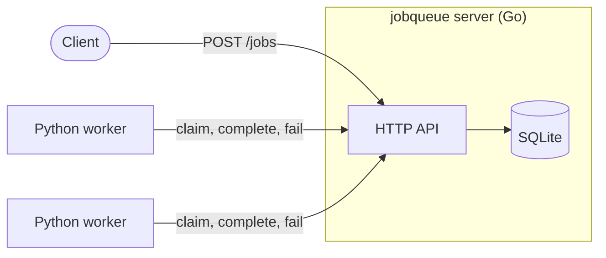
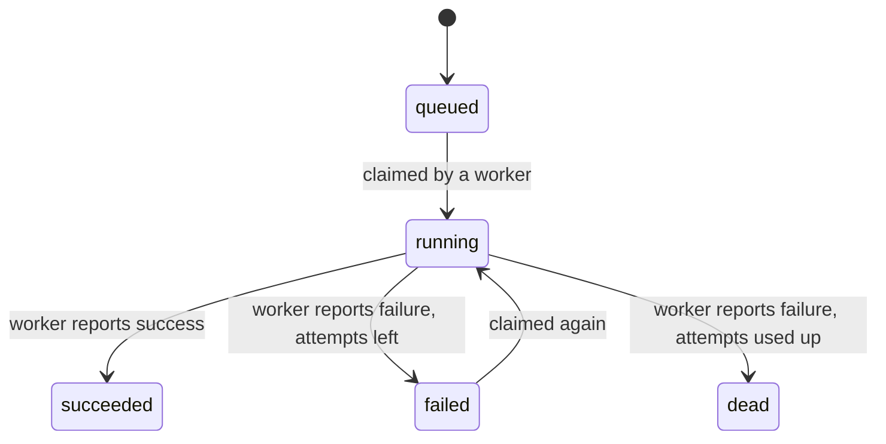

# JobQueue

[](https://github.com/2CHILON/jobqueue/actions/workflows/ci.yml)
[](https://github.com/2CHILON/jobqueue/releases)
[](LICENSE)

A small background job queue: a **Go** HTTP API with **SQLite** storage, and **Python** workers that claim jobs, run them, and report back. It is a miniature version of the systems that power things like email sending and report generation, where slow work is queued instead of making a user wait.

It is also a worked example of a full delivery pipeline: every pull request is checked by CI, and pushing a version tag produces tested binaries, a Windows installer, a GitHub Release, and Docker images.

## How it works



A client submits a job. A worker asks the API for the next job, runs it, and reports success or failure. Many workers can run at once, and each job is handed to exactly one of them.

### Job lifecycle



Jobs are claimed by highest priority first, then oldest first. A job gets 3 attempts by default. After that it becomes `dead` and is never handed out again.

## Quick start

### Docker Compose (recommended)

```bash
git clone https://github.com/2CHILON/jobqueue.git
cd jobqueue
docker compose up --build
```

This starts the server on port 8080 and one worker. Job data is kept in a named Docker volume, so it survives restarts. Run more workers with:

```bash
docker compose up -d --scale worker=3
```

### Published Docker images

```bash
docker run -p 8080:8080 -v jobqueue-data:/data capncook2/jobqueue-server:latest
docker run -e JOBQUEUE_URL=http://host.docker.internal:8080 capncook2/jobqueue-worker:latest
```

Images are tagged with the release version (for example `0.2.0`) and `latest`. They are built for `linux/amd64`.

### Windows installer

Download `jobqueue-setup_<version>.exe` from the [Releases](https://github.com/2CHILON/jobqueue/releases) page. The installer is not code-signed, so Windows SmartScreen will warn about an unknown publisher: choose **More info**, then **Run anyway**. It can install for the current user or for all users, and the database is stored in `%AppData%\jobqueue`, which uninstalling does not delete.

Each release also includes plain binaries for Windows and Linux, a zip of the Python worker, and a `SHA256SUMS.txt` file for verifying downloads.

### From source

Requires Go 1.26 or newer, and Python 3.12 for the worker.

```bash
go run ./cmd/server
```

```bash
cd worker
python -m venv .venv
# Windows: .venv\Scripts\Activate.ps1   Linux/macOS: source .venv/bin/activate
pip install -r requirements.txt
python worker.py
```

## Try it

PowerShell:

```powershell
$job = Invoke-RestMethod -Method Post -Uri http://localhost:8080/jobs `
  -ContentType "application/json" `
  -Body '{"type":"word_count","payload":{"text":"hello job queue"}}'

Start-Sleep 2
Invoke-RestMethod http://localhost:8080/jobs/$($job.id)
```

curl:

```bash
curl -X POST http://localhost:8080/jobs \
  -H "Content-Type: application/json" \
  -d '{"type":"word_count","payload":{"text":"hello job queue"}}'
```

The job should end as `succeeded` with `result: 3`.

### Built-in job types

| Type         | Payload           | Result              |
| ------------ | ----------------- | ------------------- |
| `word_count` | `{"text": "..."}` | number of words     |
| `hash_file`  | `{"path": "..."}` | SHA-256 of the file |
| `fetch_url`  | `{"url": "..."}`  | HTTP status code    |

New job types are one function plus one entry in the worker's handler table.

## API

| Method and path            | Purpose                                                        | Success                           |
| -------------------------- | -------------------------------------------------------------- | --------------------------------- |
| `GET /health`              | liveness check                                                 | 200                               |
| `POST /jobs`               | submit a job (`type`, optional `payload`, optional `priority`) | 201                               |
| `GET /jobs`                | list jobs, optionally filtered with `?status=queued`           | 200                               |
| `GET /jobs/{id}`           | fetch one job                                                  | 200                               |
| `POST /jobs/claim`         | worker takes the next job                                      | 200, or 204 if the queue is empty |
| `POST /jobs/{id}/complete` | worker reports success (`result`)                              | 200                               |
| `POST /jobs/{id}/fail`     | worker reports failure (`error`)                               | 200                               |

Errors return `{"error": "..."}`: 400 for bad input, 404 for an unknown job, and 409 when a job is not in a valid state for the request (for example completing a job that is not running).

## Configuration

| Variable        | Used by | Default                                                                                 |
| --------------- | ------- | --------------------------------------------------------------------------------------- |
| `PORT`          | server  | `8080`                                                                                  |
| `DB_PATH`       | server  | per-user config folder (`%AppData%\jobqueue` on Windows); `/data/jobqueue.db` in Docker |
| `JOBQUEUE_URL`  | worker  | `http://localhost:8080`                                                                 |
| `POLL_INTERVAL` | worker  | `1.0` (seconds)                                                                         |

`jobqueue-server --version` prints the build version.

## Project layout

```
cmd/server/          server entry point
internal/api/        HTTP handlers and routing
internal/queue/      job model and states
internal/store/      Store interface, in-memory and SQLite implementations, tests
worker/              Python worker and its Dockerfile
installer/           Inno Setup script for the Windows installer
.github/workflows/   ci.yml and release.yml
Dockerfile           server image
compose.yaml         server and worker together
```

## CI/CD

**On every pull request**, four checks must pass before merging (enforced by a branch ruleset on `main`):

- **Go (ubuntu-latest) and Go (windows-latest):** formatting check, `go vet`, build, and the test suite. The Linux run also uses the race detector.
- **Python worker:** dependency install and a syntax check.
- **Docker:** builds both images, starts the whole stack with Compose, submits a real job, and waits for a worker to complete it.

**On a version tag** (`v*`), the release workflow:

1. Runs the tests, then cross-compiles the Windows and Linux binaries with the version stamped in.
2. Packages them with the worker and a checksum file, and creates a GitHub Release with generated notes. Tags with a suffix such as `-rc1` are marked as pre-releases.
3. Builds the Windows installer with Inno Setup on a Windows runner and attaches it to the release.
4. Builds and pushes both Docker images to Docker Hub, adding `latest` only for full releases.

## Design notes

- **Atomic claiming.** Selecting the next job and marking it running happen in a single SQL statement, so two workers can never receive the same job. A concurrency test with many parallel claimers checks this against both stores.
- **One interface, two stores.** The API depends on a `Store` interface. The in-memory and SQLite implementations are verified by the same shared test suite.
- **SQLite in WAL mode** with a busy timeout, using the pure-Go `modernc.org/sqlite` driver. No C compiler is needed, which is what makes cross-compiling the Windows binary from a Linux CI runner simple.
- **State checks.** Only a running job can be completed or failed, so a late or duplicate report cannot corrupt a finished job.
- **UTC timestamps** throughout, so servers and workers in different time zones agree.

### Known limitations

- Retries happen immediately. There is no backoff delay between attempts.
- If a worker dies mid-job, the job stays `running`. There is no lease or timeout to reclaim it.
- Workers poll the API instead of being pushed work.
- SQLite allows a single writer, so this design suits one server instance. PostgreSQL would be the next step for scaling out.
- The API has no authentication.
- Docker images are built for `linux/amd64` only.

## License

MIT. See [LICENSE](LICENSE).
